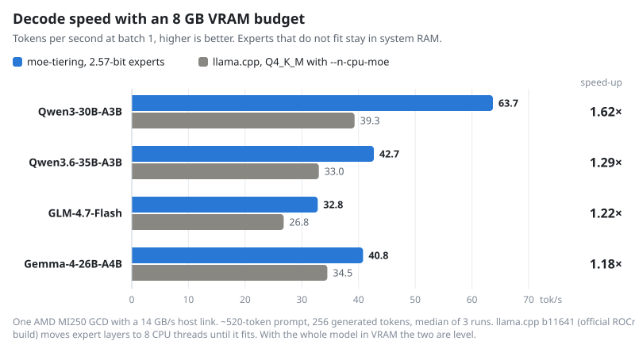

<p align="center">
  <picture>
    <source media="(prefers-color-scheme: dark)" srcset="assets/logo-dark.svg">
    
  </picture>
</p>

<h3 align="center">Run behemoth Mixture-of-Experts LLMs on one GPU plus system RAM</h3>

<p align="center">
  <a href="LICENSE"></a>
  
  
  
  
</p>

<p align="center">
  <a href="#quick-start">Quick start</a> ·
  <a href="#speed">Speed</a> ·
  <a href="#quality">Quality</a> ·
  <a href="#how-it-works">How it works</a> ·
  <a href="#supported-models">Supported models</a> ·
  <a href="#limitations">Limitations</a>
</p>

<p align="center">
  <picture>
    <source media="(prefers-color-scheme: dark)" srcset="assets/speed-8gb-dark.svg">
    
  </picture>
</p>

behemoe keeps the dense part of a Mixture-of-Experts model and its most-used experts in VRAM. The other experts
stay in page-locked RAM, and the GPU reads them over PCIe with no copy (zero-copy Triton kernels). The experts are
compressed with a 2–4.5-bit trellis code (QTIP/EXL3-style), so a 235B model fits in 24 GB of VRAM plus 64 GB of RAM.
An auto-config picks the compression level and the VRAM/RAM split for the machine it runs on.

> [!NOTE]
> **Alpha.** Tested on AMD GPUs (ROCm, Linux) and NVIDIA GPUs (CUDA, Windows). Pre-converted models are not published
> yet, so for now you convert a model yourself (see [Getting models](#getting-models)).

## Highlights

- **Big models, small GPUs.** Qwen3-30B-A3B, Qwen3.6-35B-A3B, GLM-4.7-Flash and Gemma-4-26B-A4B run in 8 GB of VRAM;
  Qwen3-235B-A22B runs in 24 GB of VRAM plus 64 GB of RAM.
- **Faster than llama.cpp when the model does not fit.** 1.2–1.6x the decode speed at 8 GB of VRAM, and 1000–1300 vs
  400–500 tokens/s prompt processing, because the GPU does all the math. With the whole model in VRAM the two are level.
- **Lower error at the same size.** 13–83% lower KL divergence from the BF16 model than llama.cpp GGUFs of the same
  size, on every model compared except gpt-oss. On the two models checked downstream, GSM8K and MMLU stay within
  noise of BF16.
- **One command picks the setup.** `behemoe plan` ranks every compression level and VRAM/RAM split that fits the
  machine; `run` and `serve` use its pick.
- **OpenAI-compatible server** with streaming chat completions.
- **AMD and NVIDIA.** ROCm on Linux, CUDA on Windows. All kernels are Triton: no CUDA or HIP extension to build.

## Quick start

Python 3.10+, PyTorch 2.6+ with CUDA or ROCm, and a GPU.

```bash
pip install git+https://github.com/damanhduc140902/behemoe
# GLM-5.x and DeepSeek-V4.1 need transformers >= 5.19:
pip install "behemoe[new-archs] @ git+https://github.com/damanhduc140902/behemoe"
```

```bash
behemoe doctor                           # GPU, RAM, library versions
behemoe plan  models/Qwen3.6-35B-A3B     # what would run on this machine (nothing is loaded)
behemoe run   models/Qwen3.6-35B-A3B     # chat in the terminal
behemoe serve models/Qwen3.6-35B-A3B --port 8000
behemoe bench models/Qwen3.6-35B-A3B     # decode / prefill speed on this machine
```

`serve` exposes an OpenAI-compatible API (`/v1/chat/completions` with streaming, `/v1/completions`, `/v1/models`):

```bash
curl http://127.0.0.1:8000/v1/chat/completions -H "Content-Type: application/json" \
  -d '{"messages": [{"role": "user", "content": "Hello!"}], "max_tokens": 200}'
```

A model directory holds one subdirectory per variant (`H4`, `TQ4.0`, `TQ3.5`, `TQ3.0`, `TQ2.57`, ...) plus the
tokenizer files. `--vram-gb` and `--ram-gb` override the detected budgets, `--variant` forces one variant, and
`--prefer quality|balanced|speed` moves the auto-config's trade-off.

### Getting models

Pre-converted models will be published on Hugging Face (`behemoe pull <model>`); this is not available yet.
Converting a model yourself needs a GPU with enough memory for one layer, a calibration corpus and several hours to
days (`python -m behemoe.convert_tcq --help`). The calibration tooling is not packaged yet.

## Speed

Decode speed at batch 1 against llama.cpp on the same GPU, same prompt (~520 tokens), 256 generated tokens, median of
three runs. Hardware: one AMD MI250 GCD (64 GB; our VRAM budget is enforced in software, llama.cpp's is its measured
peak), a host link of 14 GB/s, and llama.cpp's official ROCm build (b11641) with `--n-cpu-moe` moving expert layers
to the CPU (8 threads) until it fits the budget.

| Model | VRAM | behemoe | llama.cpp |
|---|---|---|---|
| Qwen3-30B-A3B | 8 GB | **63.7 tok/s** (2.57-bit, 7.6 GB) | 39.3 (Q4_K_M, 7.4 GB), 38.7 (Q2_K, 7.4 GB) |
| Qwen3.6-35B-A3B | 8 GB | **42.7** (2.57-bit, 7.6 GB) | 33.0 (Q4_K_M, 8.0 GB) |
| GLM-4.7-Flash | 8 GB | **32.8** (2.57-bit, 7.5 GB) | 26.8 (Q4_K_M, 7.7 GB) |
| Gemma-4-26B-A4B | 8 GB | **40.8** (2.57-bit, 7.8 GB) | 34.5 (Q4_K_M, 7.2 GB) |
| gpt-oss-120b | 22 GB + RAM | **24.7** (2.57-bit), 15.9 (3.5-bit) | 17.0 (native MXFP4, 21.6 GB) |
| MiniMax-M2 (230B) | 22 GB + RAM | 10.8 (2.26-bit), 8.9 (2.57-bit) | 10.6 (Q2_K, 21.0 GB), 14.0 (Q2_K, 25.9 GB) |
| Qwen3-235B-A22B | 23 GB + RAM | 4.7 (2.26-bit), 4.1 (2.57-bit) | 4.6 (Q2_K, 24.5 GB), 4.9 (Q2_K, 20.5 GB), 2.3 (Q4_K_M, 24.0 GB) |

Without a GGUF to compare against: GLM-5.3-Flash at 24 GB + 128 GB RAM decodes 4.3 tok/s (2.26-bit) and 3.1 tok/s
(3.5-bit); GLM-5.3 (744B) at 24 GB + 256 GB RAM ran at 1.1 tok/s (3.0-bit) before the current speed work.

With the whole model in VRAM (24 GB budget, 4.5-bit H4 vs Q4_K_M), the two are level: Qwen3-30B 110 vs 116 tok/s,
Qwen3.6 88 vs 92, GLM-4.7-Flash 90 vs 86, Gemma-4 93 vs 93. Prompt processing is faster than llama.cpp's whenever
experts live in RAM (e.g. 1000–1300 vs 400–500 tokens/s at 8 GB), because the GPU does all the math.

Where the cold experts are most of the model (MiniMax-M2, Qwen3-235B), speed is set by the host link: MiniMax-M2 at
2.57 bits reads 1.3 GB of experts per token, 11.4 GB/s here, 80% of what a plain copy reaches on this machine. A
desktop with PCIe 4.0/5.0 x16 has 2–4x this link; llama.cpp's CPU experts instead depend on RAM bandwidth and cores.

## Quality

Error is measured as KL divergence from the unquantized (BF16) model's next-token distribution. We use 84 text
windows in four sets: two familiar-text sets, and two sets of new text (recent arXiv abstracts, Vietnamese, Chinese,
Rust/C) that no quantization choice was tuned on. Each row compares our best variant **at or below the size** of a
llama.cpp GGUF of the same model. The percentage is how much lower our KL is, across the four sets. Each result was
re-run by an independent check (GLM-5.3's not yet).

| Model | ~4 bits vs Q4_K_M | ~3.5 bits vs Q3_K_M | ~2–2.5 bits vs IQ2 |
|---|---|---|---|
| Qwen3-30B-A3B-Thinking-2507 | | | −54 to −60% vs unsloth UD-IQ2_XXS |
| Qwen3-235B-A22B-Instruct-2507 | −15 to −19% vs unsloth Q4_K_M | −58 to −65% vs unsloth UD-Q3_K_XL | −59 to −65% vs bartowski IQ2_M |
| Qwen3.6-35B-A3B | −36 to −42% | −65 to −71% | no size match yet |
| Qwen3.5-122B-A10B | −38 to −47% | −70 to −73% | −69 to −76% vs IQ2_XXS |
| GLM-4.7-Flash | −41 to −53% | −65 to −75% | no size match yet |
| GLM-5.3-Flash | −24 to −33% | −44 to −48% | −31 to −35% vs IQ2_M |
| Gemma-4-26B-A4B | −46 to −53% | −78 to −83% | −74 to −80% vs IQ2_M |
| MiniMax-M2 | −13 to −30% | −36 to −51% | −54 to −60% vs IQ2_XXS |
| gpt-oss-120b, gpt-oss-20b | **we lose**: the release's native MXFP4 experts are better than our re-quantization | | |
| GLM-5.3 (744B) | no GGUF comparison yet (KL vs BF16: 0.029 at 4.5 bits, 0.041 at 3.5, 0.17 at 2.25) | | |
| DeepSeek-V4.1-Flash | runs; quality ladder not measured yet | | |

How the GGUFs were made: Qwen3-30B and Qwen3-235B use the public unsloth / bartowski files. The other models use
GGUFs we made with llama.cpp's own tools and an importance matrix from the same calibration text our converter saw.
With every non-expert weight kept in BF16, our 4-bit experts alone are level with Q4_K_M's: the 4-bit gains come
mostly from how we compress the attention and other dense weights.

### Downstream accuracy

GSM8K (first 250 test problems, greedy, step-by-step reasoning in up to 768 tokens) and MMLU (570 questions, 10 per
subject, "answer with the letter only" in up to 8 tokens), thinking off, through each engine's OpenAI-compatible
server with the model's own chat template. With 250 problems, GSM8K differences under ~4 points are noise.

| Model | Engine | GSM8K | MMLU |
|---|---|---|---|
| Qwen3.6-35B-A3B | BF16 (vLLM) | 92.0 | 83.5 |
| | behemoe 4.5-bit (H4) | 94.0 | 83.9 |
| | behemoe 3.5-bit | 93.2 | 83.2 |
| | behemoe 2.57-bit | 93.6 | 83.0 |
| | llama.cpp Q4_K_M (no imatrix) | 94.4 | 81.6 |
| | llama.cpp unsloth UD-Q4_K_M | 95.2 | 83.7 |
| | llama.cpp Q3_K_M (no imatrix) | 94.8 | 61.8 (165 replies without a letter) |
| GLM-4.7-Flash | BF16 (vLLM) | 92.8 | 71.6 |
| | behemoe 4.5-bit (H4) | 90.0 | 71.6 |
| | behemoe 2.57-bit | 89.6 | 70.2 |
| | llama.cpp Q4_K_M (no imatrix) | 92.0 | 69.0 |

## How it works

- **Experts are tiered.** Each MoE layer freezes its most-routed experts (by calibration counts) in VRAM; the rest
  stay in page-locked RAM and are read by the GPU directly (zero-copy), so a cold expert costs PCIe bandwidth, not a
  copy, and nothing has to be predicted or moved while decoding.
- **Experts are trellis-coded.** Each weight matrix is rotated with a random Hadamard transform, then coded with a
  tail-biting trellis (QTIP/EXL3-style) using full per-expert Hessians from a broad calibration corpus (BlockLDLQ).
  A per-layer rate plan spends bits where the model is most sensitive. The 4.5-bit variant (H4) uses a simpler
  4-bit row code with Hessian-weighted scales.
- **The dense part is compressed separately** (attention, shared experts, embeddings), with architecture-specific
  exceptions where low precision breaks a model.
- **Decoding is one captured GPU graph per token**: per-layer `torch.compile` of the one-token step, fused routers,
  a one-token attention path (MLA models attend over the compressed latent cache directly), and byte-wise GEMV
  kernels for the 4-bit dense weights.
- **Auto-config** ranks every variant and placement that fits the machine's VRAM and RAM by measured quality and
  estimated speed, and picks one. RAM headroom for the OS is kept.

## Supported models

Qwen3-MoE, Qwen3.5/3.6-MoE, GLM-4.7-Flash, GLM-5.3 and GLM-5.3-Flash, Gemma-4 MoE, MiniMax-M2, gpt-oss, and
DeepSeek-V4.1-Flash (our own port of the reference code; transformers has no implementation).

## Limitations

- Big models whose cold experts dominate (200B+) are limited by the host link; on our 14 GB/s test machine
  llama.cpp's CPU-side experts are as fast or faster there.
- DeepSeek-V4.1-Flash decodes without a captured graph (data-dependent sparse attention), which makes it much slower
  than the others.
- One request at a time in `serve`; each chat turn re-reads the whole conversation (no prompt cache yet).
- Speed measured on an AMD MI250 only; correctness also checked on an NVIDIA GTX 1650 laptop (CUDA, Windows).

## Acknowledgements

The trellis code follows [QTIP](https://github.com/Cornell-RelaxML/qtip) and
[ExLlamaV3](https://github.com/turboderp-org/exllamav3), and BlockLDLQ comes from
[QuIP#](https://github.com/Cornell-RelaxML/quip-sharp). Models run on
[Hugging Face Transformers](https://github.com/huggingface/transformers), kernels are written in
[Triton](https://github.com/triton-lang/triton), and [llama.cpp](https://github.com/ggml-org/llama.cpp) is the
baseline we measure against.

## License

Apache-2.0. Model weights keep their own licenses.
